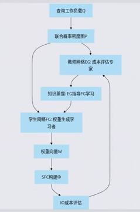

 本文给出一个面向 **Range Query** 的端到端方案：在 `d` 维网格上学习一条 **全局邻接连续（Adjacency‑Continuous, AC）** 的空间填充曲线（SFC），使得窗口查询在 1D code 轴上尽量形成少量连续区间（`#intervals` 小），从而降低 I/O / cache miss / index scan 成本。
 
 核心思想一句话概括：

 - 将“离散的访问序/排列优化（SFC）”重参数化为“学习连续边权 `W`”；
 - 用固定的离散构造过程把 `W` **解码**为合法曲线：`π = Decode(W)`；
 - 真实代价由任务指标（如 `#intervals`）定义；由于 `Decode` 不可微，训练时使用可导代理 `E(S,W)` 近似真实代价以引导生成器 `G(S)`。
 


## 一、原理优先：把 NeuralSFC 抽象成"可优化的离散问题 + 可导代理"的框架

这一节先用一套**统一抽象**概括 NeuralSFC 的方法论（原始场景常以图像像素网格为例），再把同一抽象迁移到本文的 Range Query / LAC‑SFC 设定。


 1. 问题：
 
 网格上找一条“好的”哈密顿路径（SFC）

 以图像网格为例，像素格点集合可写为：

 - `V = {(y,x) | y=0..H-1, x=0..W-1}`

 一条 SFC 本质是访问每个格点恰好一次的序列（或等价的双射 `π:[|V|]→V`）：

 - `π = (v_1, v_2, ..., v_|V|)`，其中 `v_t ∈ V` 且不重复

 你真正优化的是一个离散目标函数 `M(I, π)`（或本文中的 `Cost(D,Q; π)`），例如：

 - 图像场景：TV、AC@k、LZW length 等（都是“离散序列上的统计量”）
 - Range Query 场景：`E_{R~Q}[#intervals(R)]`（窗口在 code 轴上的区间段数）


2. 为什么不直接优化 `π`

 难点主要有两类：

 - **搜索空间爆炸**：`|V|!` 级别的排列空间不可直接搜索。
 - **解码过程离散不可导**：实际构造 `π` 常依赖生成树/合并等离散决策（例如 MST + merge/splice），无法把 `∂M/∂π` 直接反传到网络参数。

 因此关键思路是：

 > 不让网络直接输出离散的 `π`，而是让网络输出一个连续的“权重场/边权 `W`”，再用确定性的图算法把 `W` 翻译成 `π`。


3. 关键重参数化：把“找曲线”改写成“给对偶图/块图边赋权”

 以 `block_size=2` 为例，先把网格分解为很多个 `2×…×2` block：

 - 每个 block 内部先构造一个局部合法的回路/路径片段（例如 BRGC/Gray code circuit）
 - 决策空间被压缩到“block 之间如何连接/合并”

 定义 block 相邻图（也常称 dual graph / block graph）：

 - 节点：block
 - 边：相邻 block（共享一个 `(d-1)`‑face）
 - 连续权重：对每条相邻边赋一个实数权重 `w_e`

 然后用离散解码器得到曲线：

 - `T = MaxST(W)`（或对 `-W` 求 MST）
 - `π = Decode(T)`（cover‑and‑merge / splice 等固定规则）

 因而整体可写为：

 - **连续参数**：`W ∈ R^{|E|}`
 - **离散输出**：`π = π(W) = Decode(W)`

 这就是把“离散的路径/排列问题”重写为“连续边权 + 离散解码器”的核心结构。


4. baseline / 先验权重的意义：提供强参照与更稳定的学习起点

 在原 NeuralSFC 项目中，常用一个解析/启发式的 `W^0(I)` 作为 baseline（例如由局部像素差构造 dual-edge 分数）。
 其意义是：

 - 给出一个不用训练也能工作的 baseline
 - 给学习提供“合理初稿”，让网络更倾向于**做小修小补**而不是从零发明

 在 residual 训练模式中，常写为：

 - `W = W^0(S) + ΔW_θ(S)`

 其中 `ΔW_θ` 才是生成器真正学习的“修正量”。


 5. 为什么引入 Evaluator `E`（可导代理 / surrogate）

 真实目标通常形如：

 - `y_real = M(I, Decode(W))`（或 `y_real = -Cost(D,Q; Decode(W))`）

 但 `Decode` 含离散步骤不可导，因此训练一个可导代理：

 - `E_φ(S, W) ≈ y_real`

 训练 `E` 的监督信号来自“程序算出来”的真实标签：

 - 采样 `W`（来自 baseline 附近的扰动、以及训练过程中生成器产出的 `W_gen`）
 - 运行 `Decode(W)` 得到曲线 `π`
 - 计算真实指标 `y_real`

 之后训练生成器：

 - `W_gen = G_θ(S)`（或 residual 形式）
 - 通过最大化/最小化 `E(S, W_gen)` 来更新 `G`


6. 关键假设、局限与“代理偏差（surrogate gap）”

 这类方法最重要的风险点是：**`G` 优化的是 `E`，但你真正关心的是 `y_real`**。
 当 `E` 在某些区域预测不准时，`G` 会被梯度驱动“钻空子”（exploitation of model error），导致：

 - `E` 预测变好，但真实指标不提升甚至变差。

 工程上需要把“周期性真实校准”作为训练闭环的固定组件；具体训练流程与采样/回灌细节见第 9 章。


 7. 建议优先弄透的 3 个问题

 - **(1) 解码器 `Decode(W)` 的表达能力**：MST + merge/splice 可表达的曲线集合有何结构约束？
 - **(2) 指标的含义与冲突**：不同指标（TV/AC/LZW 或 `#intervals`）分别偏好什么形状？是否冲突？
 - **(3) 代理训练稳定性**：如何设计 `W` 的采样分布、如何做分布对齐与周期性真实校准？


 8. 极简心智模型

 本文 LAC‑SFC（Range Query 指标）可以抽象成一条链：

 - `S → W → Decode(W) → π → Metric/Cost`

 其中：

 - `S`：场景输入（本文的 `S=(D,Q)` 及其统计特征）
 - `W`：对偶图/块图边权（连续向量）
 - `Decode(W)`：固定离散解码器（MaxST + cover‑and‑merge/splice），保证输出 `π` 的合法性
 - `π`：最终曲线（1D 顺序/访问序）
 - `Metric/Cost`：真实目标（ `E_{R~Q}[#intervals(R)]`）

 从“训练稳定性”的角度，最关键的是分清：

 - `Decode` 与 `Metric/Cost` **都不学习**（它们是固定规则/固定度量）
 - 真正学习的是 `W`（通过 `G` 输出，或通过 residual 输出修正量）

下图展示了整体架构流程：




## 二、背景与目标

### 1. 任务背景

在多维数据（`d` 维）上进行范围查询（range query）时，常见做法是选取一条 SFC 将 `d` 维 cell/点映射到 1D 顺序（code），然后在 1D 上做区间扫描。

 SFC 的“几何好坏”会显著影响：

 - 窗口查询在 1D code 上被切分成多少个区间（`#intervals` / segments）；
 - IO 页访问数、缓存命中与索引扫描成本。

### 2. 目标

给定：

 - 数据/场景分布 `D`（例如每个 cell 的数据密度或点落入 cell 的概率）
 - 查询工作负载分布 `Q`（例如窗口大小分布、热点位置等）

 学习一条 SFC，使得：

 - **硬约束（correctness）**：覆盖所有 cell，且满足全局 AC：相邻 code 对应的 cell 必须满足 `||c-c'||_1 = 1`。
 - **软目标（performance）**：优化 query cost（例如 `#intervals`、或系统响应时间代理指标）。也允许多指标联合（例如 TV / autocorr / LZW 等作为正则或辅助项）。

 > 重要备注：Learned SFC / learned index **强依赖** query workload 的模式（query patterns）。如何获得/分析 workload 并蒸馏出可用于学习的模式，是另一个关键方向。

## 三、关键数学对象与符号

| 符号 | 含义 |
 |---|---|
 | `d` | 维度 |
 | `G` | cell 网格：`G = Π_i {0,…,H_i-1}` |
 | `N` | cell 总数：`N = ∏_i H_i` |
 | `K` | 每维量化 bit（常见设定 `H_i = 2^K`） |
 | `block_size` | 固定为 `2`（核心前提，用于维度无关的正确性闭合） |
 | `G_block` | block 网格：`Π_i {0,…,(H_i/2)-1}` |
 | `G_blk` | block 相邻图（每条边携带 `direction=k` 以及 `sign`） |
 | `W={w_e}` | block 相邻边的连续权重（可学习） |
 | `T` | 生成树（常用 Maximum Spanning Tree, MaxST） |
 | `π` | 最终 SFC（访问序 / path），`π:[N]→G` |
 | `Code(c)` | `Code(c)=π^{-1}(c)`，cell 到 1D 序号 |
 | `Decode(z)` | `Decode(z)=π(z)`，1D 序号到 cell |

### 1. 基本记号

- 记 `[n] := {0,1,...,n-1}`。

 在本文中，经常使用 `I := [N]` 表示 code space（1D 序号集合），其中 `N = 2^{K d}`。


2. 为什么称 `π = Decode(W)` 为“离散解码器”

 在本文语境中，`W` 是连续中间表示（block 相邻边权重），而 `π`（SFC 的访问序）才是结构化输出。

 `W → π` 不是学习得到，而是通过固定的离散规则“翻译”为曲线：

 - `T = MaxST(W)`（或等价：对 `-W` 求 MST）
 - 每个 block 内部 cover（BRGC/Gray code 电路）
 - 沿 `T` 做 cover‑and‑merge（2‑edge splice）得到全局 cycle
 - 剪开 cycle 得到 path 形式的 SFC

### 3. 与文献 LACSFC 的记号对齐

文献中常见标准化表述：`x∈[0,1)^d` 量化到 `K` bit 网格，每维 `2^K` 个离散坐标，因此：

 - `H_i = 2^K`
 - `G = [2^K]^d`
 - `N = 2^{K d}`

 本文的 `H_i` 记号与上述等价。

#### 3.1 多维数据集与窗口查询

多维数据集 `D` 由 `n` 个点组成，每个点 `x=(x^(1),...,x^(d))` 位于 `d` 维欧氏空间。为统一表述，通常假设点位于单位超立方体内：

 - `x^(i) ∈ [0,1)`，因此 `D ⊂ [0,1)^d`

 > 若原始数据满足 `x^(i) ∈ R`，可通过 padding / translation / scaling 将其变换到上述标准形式。

 多维窗口查询 `q` 的窗口约束记为 `q.w = [q_L, q_U]`（轴对齐）。其返回集合为：

 - `R(q) = { x | x∈D ∧ ∀i, q_L^(i) ≤ x^(i) ≤ q_U^(i) }`

 本文仅关注轴对齐窗口（最常见）。且由于一个查询由其窗口唯一刻画，后续可交替使用 `q` 与 `q.w`。

 写作 `q ~ Q` 表示从查询分布 `Q` 中采样一个窗口。

#### 3.2 网格与 cell

量化参数 `K` 决定网格粒度：将每个坐标量化到整数集合 `[2^K]`，从而在 `[0,1)^d` 上得到规则网格，共有：

 - `N := 2^{K d}` 个 cells
 - 网格 cell 集合记为 `G`
 - 每个 cell 的坐标为 `c = (c^(1),...,c^(d))`，其中 `c^(i) ∈ [2^K]`

 将点/窗口映射到离散网格的常见做法：对每维做 `c^(i)=floor(x^(i) * 2^K)` 并裁剪到合法范围。

#### 3.3 空间填充曲线（SFC）、Code 与 Decode

一条空间填充曲线（SFC）是 code space 与网格 cells 的双射：

 - `π : I → G`，其中 `I := [N]`

 常见约定（可选）是令 `π(0) = (0,0,...,0)` 作为起点规范化。

 为避免 `Code/Decode` 方向混淆，本文统一采用：

 - `Decode(z) := π(z)`（code → cell）
 - `Code(c) := π^{-1}(c)`（cell → code）

 **Definition 1 (Adjacent).** 给定两个 cell `C=(x_1,...,x_d)` 与 `C'=(x'_1,...,x'_d)`，若存在且仅存在一个维度 `k` 使得 `|x_k-x'_k|=1`，并且对任意 `j≠k` 有 `x_j=x'_j`，则称 `C` 与 `C'` 相邻。等价地：

 - `C` 与 `C'` 相邻当且仅当 `||C-C'||_1 = 1`

 **Definition 2 (Adjacency Continuous, AC).** SFC `π` 称为邻接连续（AC），当且仅当对任意 `C,C'∈G`：

 - `|Code(C')-Code(C)| = 1  ⇒  ||C-C'||_1 = 1`

 即：code space 中相邻整数对应的两 cell 必须在 `d` 维网格中相邻。

## 四、场景（Scene）表征设计

### 1. 你要学的到底是什么？

你要学习的是：给定场景 `S`（由 `D,Q` 决定），输出结构化权重 `W`，用于指导生成树 `T` 的选择，从而间接决定最终 SFC。

### 2. 可落地的 Scene 输入（从简到繁）

推荐的场景特征（可作为 `G(S)` 的输入通道）：

 - **Density grid**：`ρ(c)`（每个 cell 的数据密度/概率）
 - **Query heatmap**：`h(c)`（cell 被 query 覆盖概率）
 - **窗口参数统计**：`E[w_i]`、`Var[w_i]`，或每维窗口大小的 bucket 直方图
 - **局部共现（可选）**：仅在 `2d` 邻边上统计 joint，避免 `O(N^2)`
   - `J(c, c+e_k)`：相邻 cell 被同一 query 覆盖的概率（或近似）

 > 注：所谓“边界点排序”属于实现细节；Scene 的重点是提供足够信息让模型知道“哪些地方应聚簇”。

### 3. AC 与全局聚簇性（`#intervals`）的关系

需要明确区分两类性质：

 - **AC（硬约束，局部合法性）**：相邻 code 的两点必须网格相邻（`||·||_1=1`）。它约束的是“曲线一步怎么走”。
 - **全局聚簇性（性能目标）**：窗口命中集合在 code 轴上应尽量形成少数连续段（`#intervals` 小）。它约束的是“区域在 1D 上是否被撕裂”。

 二者并不互相推出：满足 AC 的曲线仍可能在大窗口下产生大量分段，因此必须在 Scene 表征与目标设计中显式优化聚簇性。

### 4. 建议：全局聚簇性优先在 block 级建模

在本方案中：

 - **cell 级合法性（AC + 覆盖）**：主要由每个 block 内固定的 BRGC/Gray code cover 保证；跨 block 通过“门户对齐 + splice”保证新增边仍满足 `||·||_1=1`。
 - **性能目标（`#intervals`）**：主要由 block 在 1D 上的连接布局决定。

 因此建议分工：

 - **block 级（主优化对象）**：在 block 相邻图上学习/预测边权 `W` 以驱动 `T`（以及 merge 顺序）。
 - **cell 级（局部细节）**：每个 `2×…×2` block 内固定 Gray code；如需更强表达，可允许有限种 orientation（旋转/翻转/起点切换）但必须保持 AC 与覆盖。

### 5. 局部联合概率（`2d` 邻域 joint）作为可计算 Scene 特征

若希望引入 joint 信息但避免全矩阵，可只存储每个 cell 与其 `2d` 个邻居的联合统计：

 - `J_nbr(c, δ) ≈ P(c 与 c+δ 在同一窗口查询中同时被覆盖)`，其中 `δ` 取 `2d` 个邻域方向。

 可选地，为兼顾大窗口的长程结构但保持稀疏复杂度，可加入少量多尺度邻域（例如 `δ` 取 `±2, ±4, ±8` 的轴向位移），总体仍可保持 `O(N)`。

## 五、从 Scene 到权重（Weight Generation）

### 1. 权重定义对象

权重优先定义在 **block-level 相邻边** 上。对相邻 blocks `A,B`（沿维度 `k` 相邻），输出标量 `w(A,B)`：

 - `w` 越大，表示越希望在生成树中选中这条连接（更倾向把两块优先合并）。

### 2. 生成器 `G`（Generator）

- **输入**：Scene 表征（`ρ,h,J,...`）
 - **输出**：所有相邻 block 边的权重集合 `W={w_e}`

 常见两种输出模式：

 - **absolute**：直接输出 `w_e`
 - **residual**：输出 `Δw_e`，与 baseline `w^0_e` 相加（通常更稳定）

## 六、从权重到树：MaxST（离散不可微）

- 构建 block 图 `G_blk`，边权为 `w_e`
 - 选取 Maximum Spanning Tree `T`
   - 实现上：对 `-w_e` 求 MST 即可

 `T` 决定“要优先合并哪些 block 关系”，但不直接给出 cell 级路径。

## 七、Cover‑and‑Merge（核心构造）：从 block 内电路到全局 SFC

### 1. Cover：每个 block 内构造 Hamiltonian cycle（BRGC 闭环）

- 每个 `2×…×2` block 内，用 `d`‑bit BRGC 构造遍历顺序并首尾相连成环。
 - 保证：
   - 覆盖 block 内全部 `2^d` 个 cell
   - block 内相邻步满足 `||·||_1=1`

### 2. Boundary pairing（几何配对）

对沿维度 `k` 相邻的 blocks，共享一个 `(d-1)`‑face。定义几何配对 `φ`：

 - face 上任意点 `p` 映射到 `φ(p)=p+sign·e_k`
 - 因此 `||p-φ(p)||_1 = 1`

 这一层用于保证“跨 block 新增边一定是网格邻接边”。

### 3. Merge：必须使用 2‑edge splice（两门户）

对树边 `(C1,C2) ∈ T`（此处 `C1,C2` 是当前连通分量，可能包含多个 block）：

 - 在 `C1` 的共享 face 内找到 portal edge `(u,v)`（当前 cycle 上真实存在的 face 内边）
 - 在 `C2` 的对应 face 内找到 portal edge `(u',v')`
 - 满足几何对应：`u' = φ(u)`，`v' = φ(v)`

 执行 splice：

 - 删除 `(u,v)`、`(u',v')`
 - 添加 `(u,u')`、`(v,v')`

 保证：

 - 新增跨边满足 `||·||_1=1`（全局 AC 维持）
 - 图仍为 2‑regular（每点度为 2），因此仍是一堆环
 - 环个数减少 1（两环合并为一环）

 > 注意：只做“单点 gate 插入”无法一般保证正确性，因为它会引入两处新的相邻关系而只能约束其中一处；2‑edge splice 是可证正确性的核心。

### 4. 从全局 cycle 到 SFC path

当所有 `m-1` 条树边都 splice 完成，得到单一大 cycle。剪开任意一条边得到最终 SFC path。

## 八、N 维正确性（严谨性要点）

在 `block_size=2`、每个 block 用 BRGC cycle、merge 用 2‑edge splice 的前提下：

 - **全覆盖**：splice 只改边不删点；初始覆盖所有点，因此最终仍覆盖所有点。
 - **全局 AC**：
   - block 内边：BRGC 保证 `||·||_1=1`
   - splice 新增跨边：几何配对保证 `||·||_1=1`
   - 其余边不变，因此全局相邻步均满足 `||·||_1=1`
 - **可合并性（条件式）**：每次成功 splice 会使 cycle 数减少 1；树共有 `m-1` 条边，因此在“每一步都能找到 matched portals”的条件下可得到单一 cycle。

### 1. 定理1（block 内 AC）：BRGC/Gray code 在 `2×…×2` 超立方体上的一步邻接

设一个 `d` 维 block 为 `B = {0,1}^d`（也即 `block_size=2`）。令 `GC_d = (g_0,...,g_{2^d-1})` 为 `d`‑bit Binary Reflected Gray Code（BRGC）序列，则对任意相邻项 `g_t,g_{t+1}`，存在且仅存在一个维度 `k` 使得它们在第 `k` 位不同，其余位相同，因此：

 - `||g_{t+1}-g_t||_1 = 1`

 从而将 `GC_d` 视为 cell 访问序（或将其首尾再连接成 cycle）时，block 内每一步均满足 AC。

### 2. 定理2（Gray code 递归/切片性质）：固定一维后的边界顺序仍是 Gray code

BRGC 具有递归构造：

 - `GC_d = (0|GC_{d-1}) ∘ (1|reverse(GC_{d-1}))`

 其中 `0|·` 表示在码字前附加 0（对应某一维取 0 的切片），`∘` 为拼接。

 推论：在 `B={0,1}^d` 上，固定第 `k` 个坐标为常数（0 或 1）后，剩余 `d-1` 维坐标在访问序中诱导出一个 `GC_{d-1}`（或其反向）。这为“在共享 face 上对齐门户顺序”提供了可用的规范序。

### 3. 定理3（边界对齐/几何配对）：相邻 block 的对应边界点必为网格邻接

设两个 `d` 维 blocks 沿维度 `k` 相邻，它们共享一个 `(d-1)`‑face。记几何配对 `φ(p)=p+sign·e_k`，则对任意 face 上点 `p`：

 - `||p-φ(p)||_1 = 1`

 若两侧 blocks 的 face 上门户点按上一节的 Gray code 切片顺序进行一一对应，则对应点对天然满足一步邻接。

### 4. 定理4（全局 AC）：2‑edge splice 合并不会破坏 AC

将每个 block 内部先构造成一个局部 cycle（其边全部满足 `||·||_1=1`）。对任意一次合并：

 - 删除两条 face 内部边 `(u,v)`、`(u',v')`（它们本来满足 `||·||_1=1`）
 - 添加两条跨 face 边 `(u,u')`、`(v,v')`，并要求 `u'=φ(u)`、`v'=φ(v)`

 则新增跨边满足 `||·||_1=1`，其余边保持不变，因此合并前后整体仍满足 AC。

 
 
 5. block size 可以任意调整吗？——三层 AC 分析与 `block_size=2` 的最优性

 这是一个核心设计问题。简短结论：**AC 原则上对任意 block size 均可满足，但 `block_size=2` 是使证明链最短、学习自由度最大、工程实现最简洁的唯一最优选择。**

 AC 的满足可分三层独立分析：

#### 层 1：块内 AC（intra-block）

 | 情形 | 结论 | 原因 |
 |---|---|---|
 | `B=2`，用 BRGC | ✅ 天然满足 | 每步翻转 1 bit = 坐标 ±1 → `ℓ₁=1` |
 | `B>2`，直接用 BRGC | ❌ 不满足 | 翻转第 t 位 → 坐标变化 `2^t`，不保证 ±1 |
 | `B>2`，用单步 Hamiltonian cycle（如蛇形扫描） | ✅ 可以满足 | 只要 path 上每步只动 1 格即可 |

 对任意 `B≥2, d≥2`，满足 `ℓ₁=1` 的块内 Hamiltonian cycle 理论上**一定存在**（例如 2D 蛇形扫描、d 维递归蛇形），但 `B>2` 时必须替换 BRGC，改用专门设计的单步游历曲线。

 具体地：若 block 为 `B=2^b (b>1)`，把 cell 坐标写成 `b`‑bit 整数时，直接对 `bd` 个 bit 做普通二进制 Gray code 会出现"翻转高位导致坐标变化为 `2^t`"的情况，从而不再保证 `||·||_1=1`。

#### 层 2：跨块 splice 的 AC（inter-block）

 几何配对 `φ(p)=p+sign·e_k` 给出 `||p-φ(p)||₁=1`，**与 block size 完全无关**。splice 新增的两条跨边 `(u,u')`、`(v,v')` 由 `φ` 定义保证 `ℓ₁=1`。

 ✅ **跨块 AC 对任意 B 均自动成立，无需修改。**

#### 层 3：matched portal 存在性（算法 total correctness 的核心）

 - **Portal 存在性**（至少 1 条）：face 有 `B^{d-1}` 个节点，由 cut 计数论证，内部边数 ≥ `B^{d-1}/2 ≥ 1`——对任意 `B≥2` 均成立，且 B 越大冗余越多。
 - **Matched portal 存在性**（双侧配对，难点所在）：
   - `B=2` 时：Lemma 4（`v_k` 最小节点论证）+ Theorem A（轴置换构造）给出**全维度完整解析证明**。
   - `B>2` 时："纯 portal"概念可类比推广，但 `v_k` 论证与轴置换 BRGC 构造均依赖 `{0,1}^d` 的特殊代数结构，**原有证明不能直接搬用，需重新建立**。

#### `block_size=2` 的四大优势与任意 B 的代价

 | 维度 | `block_size=2` | `block_size=B>2` |
 |---|---|---|
 | 块内 AC 构造 | BRGC，零额外设计 | 需专门单步 Hamiltonian cycle |
 | 跨块 splice AC | ✅ φ 天然保证 | ✅ 同样成立 |
 | Matched portal 证明 | Lemma 4 + Theorem A，完整闭合 | 需重新建立，原证明不适用 |
 | 学习自由度 | 最大（最小固定粒度） | 更大 block = 更多内部路径固定 |
 | 边界处理 | 2^K 网格完美对齐 | 非 2^b 的 B 需额外余量处理 |

 因此，本方案把 `block_size` 固定为 `2`，并把更大尺度的组织留给 block 图层面（以及可选的多尺度相邻特征），在保证 AC 正确性的同时最大化学习组件的优化空间。

 
 
 6. 关于“全局可合并性”的必要条件

 生成树 `T`（包含 `m-1` 条边）只保证“block 级连通”，并不自动保证每条树边都能找到可用的 matched portals。
 文中把这一点作为条件写清楚：只有当每次合并都能在共享 face 内找到一对满足 `u'=φ(u), v'=φ(v)` 的 portal edges，2‑edge splice 才能保证环数严格减少并最终得到单一大 cycle。

## 九、评价指标（Range Query 目标）

### 1. 核心优化指标体系

本方案采用**多指标联合优化**，综合评估 SFC 在 range query 场景下的性能。推荐使用以下三类指标的组合：

#### 1.1 曲线聚簇性指标（Curve-level metrics）

**mean_seg（平均连续段数，越小越好）**

对单个查询 `R`，将其命中的 cell 映射到 1D code 集合 `I(R)`，该集合在 1D 轴上分裂成若干连续段（contiguous segments）。记段数为 `#segments(R)`。

- 单查询指标：`#segments(R)` = exact contiguous segments
- 工作负载平均：`mean_seg = E_{R~Q}[#segments(R)]`

**物理含义**：段数越少，说明查询结果在 code 轴上越聚簇，I/O 访问越连续。

**mean_span（平均 code 跨度，越小越好）**

对单个查询 `R`，记其命中的 code 集合为 `I(R)`，定义：

- `span(R) = max(I(R)) - min(I(R)) + 1`

即查询结果在 1D code 轴上的"包络长度"。

- 工作负载平均：`mean_span = E_{R~Q}[span(R)]`

**物理含义**：span 越小，说明查询结果在 code 空间中越紧凑。

**mean_span_per_cell（归一化稀疏度，越小越好）**

结合 span 与实际命中数，定义单查询的"code 区间稀疏度"：

- `span_per_cell(R) = span(R) / |I(R)|`

其中 `|I(R)|` 为查询实际命中的 cell 数。

- 工作负载平均：`mean_span_per_cell = E_{R~Q}[span_per_cell(R)]`

**物理含义**：该指标可理解为"code 区间里的空洞程度"——若 `span_per_cell ≈ 1`，说明命中 cell 在 code 轴上几乎连续；若 `span_per_cell >> 1`，说明存在大量空洞（需要扫描但不命中的 code）。

#### 1.2 系统级性能指标（System-level metrics）

**mean_page_amp（平均页放大率，越小越好）** ⭐ **推荐核心指标**

该指标直接对应实际系统中的物理页访问开销，是最贴近真实 I/O 成本的度量。

**计算方法**（针对单个查询 `R`）：

1. 给定分页策略（page size = `P`），将 SFC 的 1D code 空间按顺序分页：
   - Page 0: codes `[0, P-1]`
   - Page 1: codes `[P, 2P-1]`
   - ...

2. 计算查询 `R` 实际触达的页数：
   - `pages_touched(R)` = 查询命中的 code 集合 `I(R)` 跨越的不同页数

3. 计算查询 `R` 实际命中的数据点数：
   - `hits(R) = |I(R)|`

4. 计算理论最少页数（理想情况下，所有命中点紧密排列）：
   - `pages_min(R) = ceil(hits(R) / P)`

5. 页放大率：
   - `page_amp(R) = pages_touched(R) / pages_min(R)`

**工作负载平均**：
- `mean_page_amp = E_{R~Q}[page_amp(R)]`

**物理含义**：
- `page_amp = 1.0`：理想情况，所有命中点恰好填满最少页数，无浪费
- `page_amp > 1.0`：存在页内空洞或跨页碎片，需要访问额外的物理页
- 该指标天然考虑了：
  - 查询负载分布（不同 query 的大小、位置）
  - 数据点分布（hits 在页上的分散程度）
  - 分页策略（page_size）

**反向指标（可选）**：页利用率
- `page_util(R) = hits(R) / (pages_touched(R) × P)`（越大越好）
- 但训练时使用 `mean_page_amp` 通常更直观、更稳定

#### 1.3 推荐的联合优化目标

**方案 A：三指标加权组合**（推荐起步配置）

```
Loss = α × mean_seg + β × mean_span_per_cell + γ × mean_page_amp
```

其中归一化后的建议权重：
- `α = 0.4`（段数，直接影响 I/O 次数）
- `β = 0.2`（稀疏度，影响扫描效率）
- `γ = 0.4`（页放大率，直接对应物理页开销）

**方案 B：以页放大率为主目标**（生产环境推荐）

若系统已有明确的分页策略和 I/O 成本模型，可直接优化：

```
Loss = mean_page_amp
```

并将 `mean_seg` 和 `mean_span_per_cell` 作为监控指标或正则项。

### 2. 辅助指标与 baseline 对比

**分位数指标**（用于评估 worst-case 性能）：
- `seg_95% = Quantile_0.95(#segments(R))`
- `page_amp_95% = Quantile_0.95(page_amp(R))`

**baseline 曲线对比**：
- Hilbert curve
- Z-order (Morton) curve
- Row-major scan
- 固定 baseline 权重（如基于局部密度的启发式权重 `W^0`）

### 3. 训练时的代理目标

由于上述指标均为离散不可微，训练时使用 Evaluator `E_φ(S, W)` 作为可导代理：

- `E_φ(S, W) ≈ -(α × mean_seg + β × mean_span_per_cell + γ × mean_page_amp)`

其中 `E` 通过监督学习拟合真实指标（见第十章训练流程）。

## 十、训练：Generator + Evaluator（代理网络）闭环

### 1. 为什么需要 Evaluator `E`

真实目标需要走完整链路：
 
 - `W → MaxST → splice → SFC → #intervals`
 
 该链路包含离散步骤不可微，因此用 `E` 学一个可微 surrogate：
 
 - 输入：`(S, W)`
 - 输出：`E(S,W) ≈ -Cost_true(S, Decode(W))`

### 2. 监督标签从哪里来

离线采样：
 
 - 抽样场景 `S`
 - 采样权重候选 `W`（baseline + noise + generator 输出 + replay buffer）
 - 真实解码 `π = Decode(W)` 并计算 `Cost_true`
 - 形成监督对 `(S,W) → score_true`

### 3. 训练循环（稳定版本）

- 训练 `E`：最小化 `|E(S,W)-score_true|`
 - 训练 `G`：最大化 `E(S, G(S))`（或最小化预测 cost）
 - 周期性真实校准：持续添加 `G` 当前分布附近的真实标注样本抑制 surrogate gap
 
 ---

## 十一、推理与评估流程（最终使用方式）

对新场景 `S*`：
 
 1. `W* = G(S*)`
 2. `T* = MaxST(G_blk, W*)`
 3. Cover：每个 block 构造 BRGC cycle
 4. Merge：沿 `T*` 做 2‑edge splice 得到全局 cycle
 5. 剪开成 SFC path
 6. 用真实 query workload 评估 `#intervals`（以及其它指标）并与 baseline（Hilbert / RowMajor / Z-curve 等）对比
 
 ---

## 十二、实现层面的最低正确性清单

- 必须：merge 使用 2‑edge splice（两门户），不能只做单点 gate 插入。
 - 必须：每条 tree 边携带相邻维度 `direction`（以及方向 `sign`）以确定共享 face。
 - 建议：portal edge 从"当前 component 的 cycle"里实时搜索/校验（或维护可更新的 portal 缓存）。
 - 必须：任何时候都不得引入 `||·||_1>1` 的跨越边（AC 的硬禁区）。

---

## 十三、扩展方向：查询自适应分区粒度

### 1. 核心洞察：量化步骤（CELL 粒度）是局部性保持的根本瓶颈

当前 LACSFC 的优化发生在"block 之间的连接顺序"层面，但固定 `2×2` block 对空间的均匀切分引入了一个**结构性天花板**：

- 当查询窗口与 block 边界不对齐时，一个"本应连续"的查询被人为切成多个 interval
- 这个损失无论怎么优化曲线排序都无法弥补——它来自量化粒度本身
- 真正的最优是**联合优化 Cell 划分 + 曲线排序**，而非固定 Cell 后只优化排序

这一洞察把优化目标从：

```
固定 Cell → 优化 排序（curve）
```

升级为：

```
联合优化 Cell 划分 + 排序（curve）
```

### 2. 挑战 1：非均匀 block 下 AC 能否保证？

**结论：可以，但需要区分两个层次。**

**跨块 splice 的 AC**：`φ(p) = p + e_k` 只依赖"两侧 face 上的点在几何上差 1 格"，与 block 尺寸无关——只要相邻 block 的 face 在坐标上是对齐的，新增跨边 `ℓ₁=1` 就自动成立。

**块内 AC**：任意矩形区域内都存在满足 `ℓ₁=1` 的 Hamiltonian path（蛇形扫描），与尺寸无关。

**真正的风险**在于：非均匀 block 之间 face 节点数不等时，portal 配对可能失效——这才是 AC 被打破的关键点（见挑战 2）。

### 3. 挑战 2：不同尺寸 block 的 face 节点数不等，splice 如何配对？

若左侧 block 是 `3×4`、右侧是 `2×6`，face 的节点数分别为 3 和 2，无法做简单 1-to-1 配对。

**解决方案：使用 quadtree/octree 风格的对齐约束。**

大 block 总是 `2×2` 基础 block 的整数倍，且边界必须对齐到基础 block 边界：

```
4×4 super-block 与 4×4 super-block 相邻 → face 各有 4 节点 → 可配对 ✅
4×4 super-block 与 2×2 base-block 相邻 → face 4 vs 2       → ⚠️ 需处理
```

对节点数不等的情况，有两种处理方式：

- **只在同层 block 之间做 splice**（强制分辨率一致的区域相邻）——最简洁，AC 完全保证
- **用"接触面最小公共子集"配对**（只配对 face 中对齐的部分，牺牲部分 portal 候选）——更灵活，AC 仍可保证

两种都可以维持 AC，代价是对分区结构加了对齐约束。

### 4. 挑战 3：分区本身是 NP-hard 的，训练信号如何传导？

**结论：工程上可以解决，不需要全局最优。**

NP-hard 指的是找**全局最优分区**，但梯度优化做的是"找到一个局部最优的好分区"——这是两件事。训练信号可通过软分区传导：

```
分区决策（可微松弛，如软 k-d tree 分割点或 soft spatial assignment）
    ↓
生成 block 图
    ↓
MaxST → splice → SFC → 评估指标（mean_seg / mean_page_amp）→ 梯度回传
```

这与神经架构搜索（NAS）的思路一致，有成熟工具支持。

### 5. 两种技术路径的对比

| 方案 | AC 保证 | 实现代价 | 效果上限 | 适用场景 |
|---|---|---|---|---|
| 保持 `2×2`，只增强 edge weight（涵盖 joint query prob、aspect ratio、density） | ✅ 不变 | 低 | 受 MaxST 全局排序限制 | 快速迭代、验证想法 |
| quadtree 分层合并 super-block | ✅ 需对齐约束 | 中 | 能捕捉区域级聚类 | 有明显冷热区域的负载 |
| 完全任意非均匀 block | ⚠️ 需重建 portal 证明 | 高 | 理论上限最高 | 长期研究方向 |

**关于"增强 edge weight 是否足够"**：

将 `W(b_1, b_2)` 设计为涵盖查询负载联合概率、查询窗口长宽比、数据点密度的综合信号后，MaxST 会自然优先连接"经常被同一查询同时命中"的 block 对，隐式地实现聚类效果。但存在一个边界条件：

> 若一个 `8×8` 热点区域内有 16 个 `2×2` block，MaxST 能保证它们连通，却**不能保证它们在 1D code 上连续排列**（中间可能插入其他 block）。显式 super-block 能直接编码"把这 16 个视为一个整体"，rich edge weight 无法做到同等效果。

### 6. 推荐渐进路径

```
阶段 1（当前可执行）：
  增强 edge weight → 加入 joint query probability + aspect ratio + data density
  → 零额外代价复用全部现有框架，验证 query-adaptive 信号的效果上限

阶段 2（中期）：
  引入 quadtree 分层合并 super-block
  → 保留 2×2 作为原子单元（AC 证明链不变）
  → 热点区域细粒度、冷点区域压缩，直接对应查询局部性
  → MST 的节点变为 super-block，splice 在 super-block 图上执行

阶段 3（长期研究）：
  完全查询自适应分区 + 重建 portal 证明体系
  → 理论上限最高，需从头建立新的 matched portal 存在性证明
  → 参考 §3.4 关于 block_size 可扩展性的分析
```
